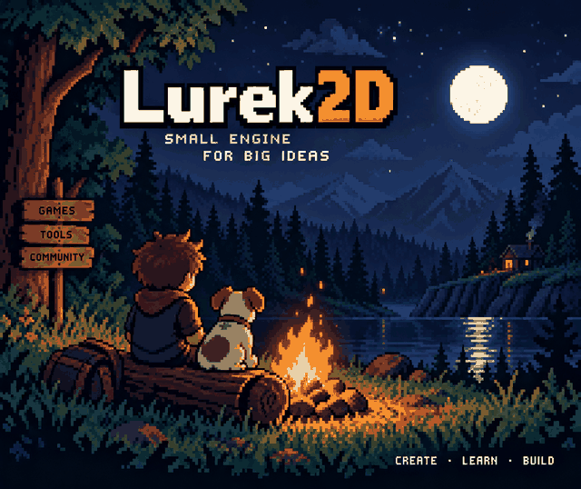

# Moonlit Camp — Lurek2D artwork

This is a small, **AI-generated pixel-art concept** inspired by making 2D games with Lurek2D. A creator and a dog sit by a campfire overlooking a quiet lake and mountains under the moon.

## Asset details

- **File:** [`moonlit-camp.png`](./moonlit-camp.png)
- **Format:** PNG, 640 × 538 px
- **Purpose:** Optional promotional/showcase artwork. The engine does not load or depend on this image.
- **Origin:** Generated with OpenAI image generation, then exported as a compact PNG.

The image is a creative concept, not an in-engine screenshot or an official Lurek2D logo.
